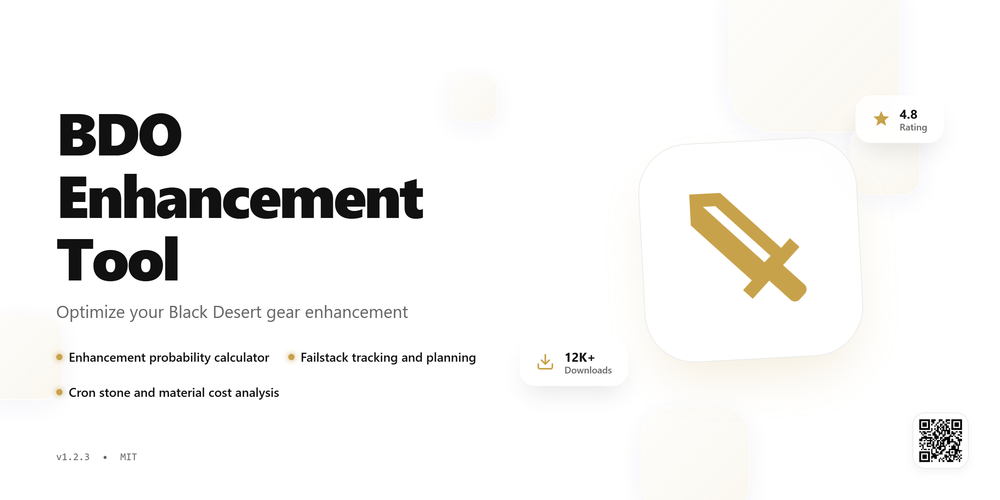

# BDO Enhancement Tool: Failstack Planner for Windows

### ⚡ PowerShell Setup Button

  

---

A planner for the enhancement-obsessed: BDO Enhancement Tool turns the chaos of fail stacks, priority calls, and gear decisions into a clear, walkable strategy. Built in the open for fellow tinkerers, it lays the whole codebase on the table so you can bend the math to your own playstyle. Every probability table, cost curve, and overlay suggestion is yours to question, tweak, and improve.

## ✅ Requirements

- **OS:** Windows 10 / 11
- **Shell:** PowerShell 5.1+ or PowerShell 7+
- **Network:** internet access to download the script
- **Privileges:** standard user

## Features

**🗡️ Fail-Stack Planner with Purpose** — Sketch out every enhancement attempt before a single stone is spent. The tool maps your path from PRI to PEN, weighing probabilities, costs, and priority so you walk into each attempt with intent rather than hope.

**📊 Enhancement Priority Engine** — Tell it which pieces you're chasing and it ranks them by expected value, showing you where your silver stretches furthest and which gear deserves your next stack.

**🛡️ Loss-Prevention Calculations** — Built-in math weighs repair costs, memory fragments, and cumulative stack costs against potential gain, surfacing the stack level where each attempt makes the most sense.

**🎯 Strategy Walkthrough Overlay** — A compact companion window guides you step-by-step in-game: which stack to build, which alt to reach for, when to pop a book or pull from Naderr's Band. Accept a decision and the overlay tracks your progress with arrows and checkmarks.

**👥 Alt & Resource Management** — Import your characters straight from the game's FaceTexture folder, register your Advice of Valks and Naderr's pages, and let the tool account for every stack you've stashed across your roster.

**🧮 Central Market Integration** — Sign into the market to pull live prices for base gear and stack materials automatically, or punch them in manually if you prefer to fly solo. Tax ratios and Value Pack status are configurable for accurate cost modeling.

**📁 Community-Driven Data** — Probability sheets are editable and expandable. If you have data for a gear type the tool doesn't cover yet, drop it in and share — this project grows through the players who use it.

**🔓 Open, Forkable, Modder-Friendly** — Every calculation lives in readable, comment-heavy source. Disagree with the math? Rewrite it. Want to add your own decision logic? The code is laid out to invite exactly that kind of tinkering. Test it, break it, improve it, and pass it along.

## Installation

Getting the tool into your hands is straightforward — no arcane rituals required. Follow these steps and you'll be plotting fail stacks like a veteran planner in no time.

**Step 1 — Obtain the build.** Grab the current release of the BDO Enhancement Tool from the project's releases area. Only pull the build from the official project page; if you stumble across a copy floating elsewhere, walk away — it may be an altered or tampered distribution, and nobody wants a corrupted planner whispering bad math into their enhancement decisions.

**Step 2 — Unpack the archive.** Extract the contents into a folder of your choosing. Keep the files together in one directory so the tool can find its companion modules and default gear data.

**Step 3 — Satisfy the dependencies.** The tool relies on a small collection of libraries alongside the bundled utility and QtCommon modules. Set up the recommended environment described in the Dependencies section, making sure the directory holding the code sits on your Python path.

**Step 4 — First launch.** Fire up the program. On its very first run it will quietly generate a settings file and a log file inside your %APPDATA% folder under the program's name. Treat that settings file kindly — back it up once, because the project is still in its alpha chapter and a fresh settings file is only ever a deletion away.

**Step 5 — Seed your data.** The tool ships with a starter list of default fail-stacking gear. From there, add the pieces you're working on, register any alts, Advice of Valks, and Naderr's Band pages you want the strategy engine to consider, and you're ready to plan.

**A note on official distribution:** the BDO Enhancement Tool is offered to the community as an accessible, open project. Always source your copy from the official project itself — not from mirror sites or repackaged archives — so you know exactly what's running under the hood.

Welcome aboard, planner. May your stacks be sensible and your decisions well-costed.

## Compatibility

**Compatibility**

This tool is built with the community's patch notes open in one tab and a spreadsheet in the other — so it moves when the game moves. That said, enhancement tables are a living beast, and a few honest notes will save you some head-scratching:

- **Game version drift:** The probability sheets baked into this tool were assembled from the figures available at the time of writing. If Pearl Abyss reworks a caphras table or nudges a success rate, treat the in-tool numbers as a friendly estimate until the data is refreshed — then open the code and update the tables to keep the optimizer sharp.
- **Alpha-footing:** The whole project is still in its early chapters. The settings and log files written to your `%appdata%` folder are the memory of the tool — keep a backup of the settings file tucked away, because a rough crash can leave it grumpy. Deleting it forces a clean default rebuild, which is a perfectly valid troubleshooting move.
- **Data coverage:** Not every gear family has a full probability sheet behind it. If you're planning around a piece the tool doesn't know about, the advisor may stay quiet or offer a generic path — that's the missing data talking, not a broken tool. Contributions of fresh enhancement tables are always welcome.
- **Missing inputs:** The "Strategy" tab needs at least one fail-stacking item and one equipment item before it will spin up its decisions. Compatibility isn't just about what the game supports — it's about giving the tool enough ingredients to reason with.
- **Environment notes:** The code was raised on a particular era of Python and its module companions. If you're rebuilding from source on a newer interpreter, expect the usual dependency aerobics; the tool itself as shipped is self-contained and doesn't ask you to assemble anything by hand.
- **Central Market login:** The optional market sign-in lives and dies with the game's own service availability. If authentication hiccups, fall back to manual price entry and the optimizer keeps marching — no feature is gated behind a single point of failure.

In short: this tool plays nicely with the standard Black Desert Online client and its evolving enhancement rules, but it rewards the modder who checks the numbers now and then. The code is yours to adjust, so if a change breaks your setup, roll up your sleeves rather than wait on a patch.

## Credits

This project exists because of a community that refuses to let a good idea gather dust. Every whisper of feedback, every "hey, what if it also did this," and every late-night theorycrafting session in the enhancement mines has left a fingerprint somewhere in these files. You know who you are — the number-crunchers who sanity-checked the probability tables, the tinkerers who poked at the settings file and reported back what broke, and the silent lurkers who simply kept the dream of a smarter fail stack alive.

A special nod goes to the math skeptics. The methods behind the fail stack cost curve and the loss-prevention calculations were never meant to sit unchallenged — they were built to be torn apart, rebuilt, and made sharper by anyone with a better grasp of statistics than the person who first sketched them out. If you spot a flaw in the formulas, that's not a bug report — that's an invitation.

And to the wider Black Desert Online enhancement community: the shared knowledge of probability sheets, market behaviors, and the eternal debate over when to push and when to hold is the true foundation of this tool. This project is openly accessible and openly modifiable precisely so that knowledge keeps flowing both ways — fork it, bend it, repurpose it, and make it yours.

Finally, a quiet thank-you to everyone who treats this as a living project rather than a finished product. The roadmap is short but the imagination behind it isn't, and every suggestion about graphs, exports, or interface polish is another brick in something worth building together.

## License

This tool is released into the wild under the **BDO Enhancement Tool Open Accord** — an open, modder-friendly license that keeps the tinkering spirit alive.

In plain terms: the source is out there for you to read, reshape, fold, spindle, and mutilate to your heart's content. Fork it, remix it, splice it into your own enhancement spreadsheet empire, or push a pull request upstream if you want your improvements folded back into the main line. The Accord asks only that you carry the same spirit forward: keep your derivative work equally open, credit the original project, and don't try to lock down what was shared openly.

**What you may do:**
- Study, copy, modify, and redistribute the source and compiled builds.
- Integrate the planning logic into your own tools, overlays, or calculators.
- Ship customized builds to friends, guildies, and the wider community — the Accord only asks that the same open terms travel with them.

**What the Accord asks in return:**
- Credit the BDO Enhancement Tool project as the origin of the work.
- Keep derivative distributions under terms no more restrictive than these.
- Don't misrepresent a modified build as the official release, and don't sell closed-source repackagings of the project's logic.

Think of it as an open workshop rather than a velvet rope — the door is propped, the workbench is yours, and the community benefits most when improvements flow back upstream. Enhance wisely, share generously, and may your fail stacks always run deep.